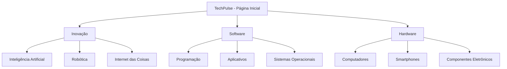

# TechPulse - Portal de Notícias de Tecnologia

## 1. Sobre o projeto

O TechPulse é um portal de notícias de tecnologia desenvolvido
com o objetivo de apresentar informações sobre inovação,
software, hardware e tendências tecnológicas.

O projeto consiste em uma página inicial responsiva, com
navegação por categorias e organização semântica do conteúdo.

## 2. Objetivo

Desenvolver uma interface web funcional, acessível e responsiva,
aplicando os conceitos de HTML5, CSS3, Box Model, arquitetura
da informação e separação entre estrutura e estilização.

## 3. Tecnologias utilizadas

- HTML5: estruturação semântica do conteúdo.
- CSS3: estilização e organização visual.
- Flexbox: alinhamento dos elementos da interface.
- CSS Grid: distribuição das categorias.
- Media Queries: adaptação para dispositivos móveis.
- Git e GitHub: versionamento e publicação do projeto.

## 4. Estrutura do projeto

TechPulse/
├── index.html
├── style.css
├── README.md
└── imagens/
    └── tecnologia.jpg

## 5. Identidade visual

### Paleta de cores

| Cor | Código | Finalidade |
|---|---|---|
| Azul-escuro | #0F172A | Cabeçalho e rodapé |
| Azul secundário | #1E293B | Área de apresentação |
| Azul-claro | #38BDF8 | Botões e destaques |
| Branco | #FFFFFF | Cards e textos |
| Cinza-claro | #F1F5F9 | Fundo da página |

A escolha da paleta azul está relacionada aos conceitos de
tecnologia, inovação, confiança e profissionalismo.

O contraste entre cores claras e escuras contribui para
a legibilidade e a identificação dos elementos da interface.

### Tipografia

Foi utilizada a fonte Arial, com Helvetica e sans-serif
como alternativas.

A escolha foi realizada considerando a legibilidade,
simplicidade e compatibilidade entre navegadores.

Os títulos possuem tamanhos superiores aos textos comuns,
estabelecendo uma hierarquia visual de informações.

### Espaçamento e Box Model

Foram utilizadas as propriedades margin, padding e border
para organizar os elementos, separar os conteúdos e
proporcionar uma leitura confortável.

O uso de espaçamentos também evita a concentração
excessiva de informações na interface.

## 6. Espaços do portal

### Página inicial

Apresenta o portal, suas principais tecnologias e um
botão de acesso às categorias.

### Inovação

Espaço destinado às tecnologias emergentes.

Subcategorias:

- Inteligência Artificial
- Robótica
- Internet das Coisas

### Software

Espaço destinado aos sistemas e soluções digitais.

Subcategorias:

- Programação
- Aplicativos
- Sistemas Operacionais

### Hardware

Espaço destinado aos equipamentos tecnológicos.

Subcategorias:

- Computadores
- Smartphones
- Componentes Eletrônicos

## 7. Sitemap Visual

## 8. Hierarquia de conteúdo e taxonomia

A arquitetura da informação foi organizada em três níveis:

- Nível 1: página inicial.
- Nível 2: categorias principais.
- Nível 3: subcategorias temáticas.

A taxonomia foi definida pelo agrupamento de assuntos
relacionados, facilitando a localização das informações
e permitindo futuras expansões do portal.

As categorias e subcategorias estão representadas na
página inicial, sem a necessidade de páginas adicionais
nesta primeira versão.

## 9. Tecnologias e serviços abordados

- Inteligência Artificial: automação e inovação digital.
- Computação em Nuvem: armazenamento e processamento remoto.
- Internet das Coisas: integração de dispositivos conectados.

Esses assuntos foram escolhidos por sua relevância no
cenário tecnológico e pela diversidade de aplicações.

## 10. Responsividade

O projeto utiliza Flexbox, CSS Grid e Media Queries
para adaptar a interface a diferentes tamanhos de tela.

Em dispositivos móveis, os elementos são reorganizados
verticalmente para facilitar a navegação e a leitura.

## 11. Acessibilidade

O projeto utiliza:

- Tags semânticas do HTML5.
- Texto alternativo na imagem.
- Hierarquia de títulos.
- Contraste entre textos e fundos.
- Indicadores de foco para navegação por teclado.
- Identificação do idioma da página.

## 12. Como executar

1. Baixe ou clone o repositório.
2. Abra a pasta do projeto.
3. Execute o arquivo index.html no navegador.

Não é necessária a instalação de dependências.

## 13. Versão

Versão 1.0.0 - Desenvolvimento da página inicial.

Projeto acadêmico desenvolvido para aplicação dos
conceitos de desenvolvimento Front-End.

## 14. Teste
A responsividade foi testada em ambiente desktop e em uma resolução mobile de 400 × 523 pixels, utilizando as ferramentas de desenvolvedor do navegador. Durante os testes, foi verificada a reorganização vertical dos elementos, a adaptação das imagens e a legibilidade dos conteúdos. Os links de navegação interna também foram testados com sucesso na versão desktop.